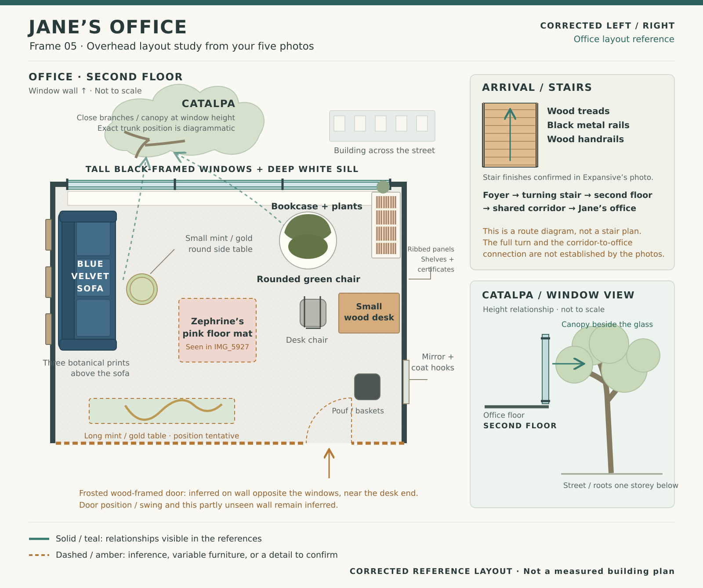

# Frame 05 — Jane's office layout for confirmation

**Status:** left/right corrected at Oleg’s direction. He subsequently asked to
build the office revision. October 24, 2026. See the
[implementation review](../05-real-office/README.md) for build and release status.

[Zoomable vector schematic](office-layout.svg).

This revises the planning for the existing office-move memory, frame `05`.
It does not reserve a frame, replace the emotional brief or imply approval of
the existing scene's artistic quality. Dimensions are not measured. Diagram
top is the window wall; no geographic orientation is asserted. The corrected
plan puts the sofa on the left and bookcase, desk, rounded chair and entry on
the right. The two sidebar insets retain their original orientation.

## What the references establish

- `IMG_0277`: tall black-framed window wall and deep white sill; white bookcase
  and small wood desk at one end; rounded white-shell chair; ribbed beige
  panels, shelves, framed certificates, mirror and hooks; wood-framed frosted
  entry door. A long mint/gold table is visible in the foreground.
- `IMG_2383`: green upholstery in the rounded chair; books and plants at the
  window/bookcase end; daylight view down to parked cars and the street.
- `IMG_5927`: blue velvet sofa against the other end wall, three botanical
  prints above it, small mint/gold round table, and Zephrine on a pink floor
  mat between the seats. A large, close tree trunk and branches are outside
  the glass at office height. The user identifies the required tree as catalpa.
- `IMG_6814` and `IMG_6858`: the chair/bookcase/window relationship in another
  lighting condition; trees, the opposite building and street below.

The photos span different arrangements. The schematic does not assume every
movable object was present at once. Temporary storage, the ladder, legible
certificates and private document content are not part of the proposed set.
Original HEIF files and decoded inspection copies remain private and ignored;
no reference pixels or photo metadata are included in these diagrams.

## Stairs: public reference actually inspected

- [Expansive North Center location](https://expansive.com/locations/illinois/chicago/chicago-north-center/)
  at 3838 N Ravenswood Avenue.
- [Operator's foyer / stairs photo, Chicago_NorthCenter-3](https://expansive.com/wp-content/uploads/2024/04/Chicago_NorthCenter-3.webp).

The inspected photo shows wood treads and handrails, black metal uprights and
stringers, and a turning stair over the reception area. The entire stair turn
and the route from its upper landing to Jane's particular office are not
established by this photo. The inset therefore records materials and the
logical arrival sequence rather than presenting an invented building plan.
The public reference image itself is not copied into the repository.

## Remaining reference uncertainties

1. The drawing infers the frosted door on the wall opposite the windows, near
   the bookcase/desk end. Its precise location and inward swing need correction
   if inaccurate. This partly unseen wall and all room proportions are tentative.
2. The long mint/gold table is drawn toward the opposite-window side; its exact
   orientation and relation to the entry need confirmation. The pink mat is a
   visit-specific object, not fixed architecture.
3. The exact upper-landing-to-office corridor is not established by the photos.
   With the subsequent build authorization, the implementation uses a composed
   connection rather than claiming a surveyed building plan.

The tree's drawn trunk location is diagrammatic. Its required spatial
relationship is firm: close catalpa branches/canopy beside the second-floor
glass, and a street/ground plane below the office, visible from near the sill.

## Verification of this deliverable

All five office images were decoded and visually inspected, together with the
operator's stair photograph. The SVG was rasterized and inspected; overlapping
labels were corrected. No functional site tests were needed for this planning
artifact. This initial diagram is a layout reference. Subsequent 3D geometry, collisions,
portal movement and portrait-emulation evidence are recorded separately in the
[implementation review](../05-real-office/README.md).
